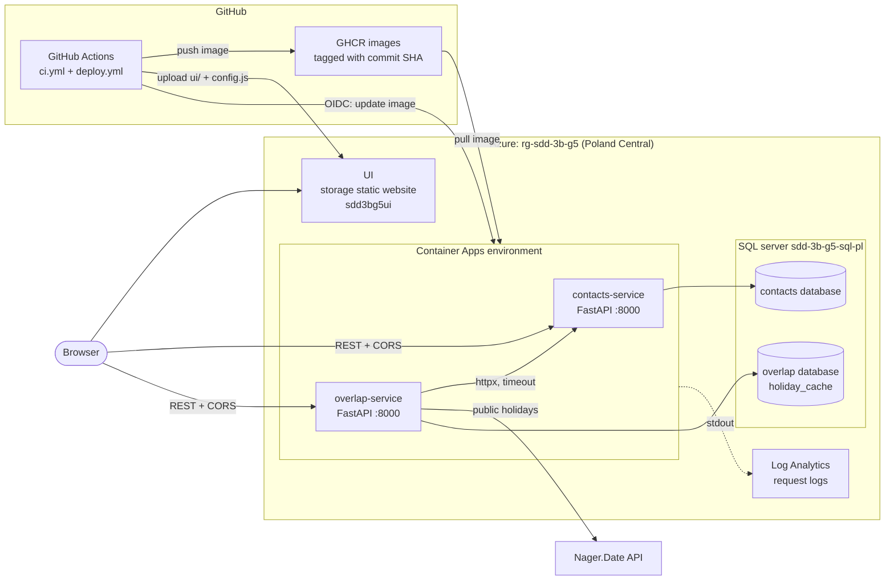

# Calling-home planner

A small web app that helps people living abroad find good times to call family and
friends back home, and tells them who they have not called in a while.

Scrum on Azure group assignment. MVP deadline: 24 Nov 2026, 23:59.

## What the product does

- **contacts-service** (Python FastAPI): stores contacts with home city, time zone,
  sleep hours, preferred call length and how often to call, plus a log of calls made.
- **overlap-service** (Python FastAPI): fetches contacts from contacts-service, finds the
  best call windows over the next 7 days, ranks contacts by how overdue they are, and
  flags public holidays in the contact's country (Nager.Date, cached). It also stores the
  user's own week (time zone, sleep hours, weekly busy times; `/me`), which the windows
  avoid. Overlapping busy times are refused.
- **UI**: plain HTML/JS served as an Azure Storage static website: a "This week" grid,
  "My week" to edit your own busy times, and a contacts page with the call log.

If overlap-service or Nager.Date is down, contacts and the call log still work and the
UI shows "Suggestions unavailable right now".

## Architecture



The browser loads the UI from storage and calls both services directly; `config.js`
(written by the pipeline) tells it their addresses. overlap-service reads contacts from
contacts-service, so if contacts-service is down there are no suggestions, but if
overlap-service is down the contacts page still works. Each service has its own database
and its own database user.

## Repository layout

| Folder | Contents |
| --- | --- |
| `contacts-service/` | Contacts and call-log API |
| `overlap-service/` | Call-window suggestions and holiday flags |
| `ui/` | Static front end |
| `docs/` | Decisions, data model, Scrum files |

## Team

| Name | GitHub | Workstream |
| --- | --- | --- |
| Alexandra | alemol123 | contacts-service |
| Luna | lunalarcher06 | overlap-service |
| Alicia | aliciaamueller | Frontend + integration |
| Tatiana | TatianaQuinnIE | CI/CD pipeline |
| Sanad | sanadhamadd | Azure infrastructure + monitoring |

## Run locally

You need Docker Desktop. On Apple Silicon, turn on "Use Rosetta for x86_64/amd64
emulation" in Docker Desktop's settings, because SQL Server only ships an amd64 image.

1. Create your `.env` from the example and choose your own local passwords
   (8+ characters with 3 of: uppercase, lowercase, number, symbol):

   ```bash
   cp .env.example .env
   ```

2. Start everything:

   ```bash
   docker compose up --build
   ```

3. Open the UI at http://localhost:8080. Both services should show **OK**.

| Container | Local address | What it does |
| --- | --- | --- |
| `db` | `localhost:14331` | One SQL Server holding both databases |
| `db-init` | n/a | Runs `db/init.sql` (both databases, one login per service), then exits |
| `contacts-service` | http://localhost:8001 | Contacts and call log, logs in as `contacts_user` |
| `overlap-service` | http://localhost:8002 | Call suggestions, logs in as `overlap_user`, calls contacts-service through `CONTACTS_SERVICE_URL` |
| `ui` | http://localhost:8080 | Stock nginx serving `ui/` |

Each service applies its migrations on startup. Both have their API docs at `/docs`
(e.g. http://localhost:8001/docs).

**Run a single service** (compose also starts `db` and `db-init`, which it needs):

```bash
docker compose up --build contacts-service
```

**See partial failure**: `docker compose stop contacts-service`, then click
**Check again** in the UI. contacts-service shows "not responding" and overlap-service
keeps working.

**Stop**: `docker compose down`. The database has no volume, so this also deletes the
local data, and the next `up` starts from empty databases.

## Run the tests

The tests use an in-memory fake instead of SQL Server, so they need Python 3.12 but no
Docker. Run them per service, the same way CI does (shown for contacts-service; replace
the folder name for overlap-service):

```bash
cd contacts-service
python3.12 -m venv .venv
.venv/bin/pip install -r requirements-dev.txt

.venv/bin/python -m pytest --cov --cov-report=term-missing --cov-fail-under=70
.venv/bin/ruff check .
.venv/bin/ruff format --check .
```

`pytest` fails if coverage of `app/` drops below 70%, and CI runs the same three
commands on every pull request.

## Live URL and Azure setup

### Where it runs, and why

The pipeline identity we were meant to get in the IE group subscription
(`sdd-3b-g5-github`) was never created, and we can't create it ourselves there (no role
assignments allowed). The professor told us to run on an individual Azure for Students
subscription for now, so everything runs in Sanad's subscription, resource group
`rg-sdd-3b-g5` in **Poland Central**. If the group identity arrives later we move back: the
Bicep files work in both places.

Two things differ from the group subscription:

- Static Web Apps aren't offered in any region our subscription allows, so the UI is a
  **Storage static website** instead.
- The databases use the **free Azure SQL offer** (auto-pause 60 min and 32 GB, fixed by Azure).

The first setup we made in the IE subscription (West Europe) is still there but unused.

### Live URLs

| Part | URL |
| --- | --- |
| UI (Storage static website) | https://sdd3bg5ui.z36.web.core.windows.net |
| contacts-service | https://sdd-3b-g5-contacts.delightfulrock-fea08312.polandcentral.azurecontainerapps.io |
| overlap-service | https://sdd-3b-g5-overlap.delightfulrock-fea08312.polandcentral.azurecontainerapps.io |

Both services run the images the pipeline builds from `main`. After a quiet period the
first request can take up to a minute (503 "App port is not ready"), because the
container starts from zero and the database resumes from auto-pause.

### What runs in Azure

Defined in [`infra/main.bicep`](infra/main.bicep),
[`infra/pipeline-identity.bicep`](infra/pipeline-identity.bicep) and
[`infra/monitoring.bicep`](infra/monitoring.bicep).

| Resource | Name | Settings |
| --- | --- | --- |
| Log Analytics workspace | `sdd-3b-g5-logs` | 30-day retention, 1 GB/day cap |
| Container Apps environment | `sdd-3b-g5-env` | Consumption plan, logs to the workspace above |
| Container App | `sdd-3b-g5-contacts` | 0-1 replicas, 0.25 vCPU, 0.5 GiB |
| Container App | `sdd-3b-g5-overlap` | 0-1 replicas, 0.25 vCPU, 0.5 GiB |
| SQL server | `sdd-3b-g5-sql-pl` | TLS 1.2+, firewall: Azure services only |
| SQL database | `sdd-3b-g5-contacts-db` | Serverless Gen5 0.5-1 vCore, free offer, user `contacts_app` |
| SQL database | `sdd-3b-g5-overlap-db` | Serverless Gen5 0.5-1 vCore, free offer, user `overlap_app` |
| Storage account | `sdd3bg5ui` | Static website (`$web`), serves the UI |
| Managed identity | `sdd-3b-g5-github` | Contributor on `rg-sdd-3b-g5` only; trusts GitHub runs on `main` |
| Workbook + saved queries | `sdd-3b-g5 monitoring` | Request count, error rate, response time and the SLO; see [docs/monitoring.md](docs/monitoring.md) |

Configuration reaches the services only through environment variables. Database
passwords are Container Apps secrets. CORS allows only the UI's address and is handled in
the service code, not in the Container Apps ingress. Each service's database user can only
reach its own database (`db_ddladmin`, `db_datareader`, `db_datawriter`).

### Reproduce the setup

The initial setup is run once by one member. After that, only the pipeline changes
anything. No password is ever written in the repository. Commands are Bash (in zsh,
`repo:$X:ref` loses characters).

1. Select the subscription and check its allowed regions:

   ```bash
   az account set --subscription "Azure for Students"
   az policy assignment list --query "[].parameters.listOfAllowedLocations.value" -o tsv
   ```

2. Register the providers once, then create the resource group:

   ```bash
   for p in Microsoft.App Microsoft.OperationalInsights Microsoft.Sql Microsoft.Storage Microsoft.ManagedIdentity; do
     az provider register -n $p
   done
   az group create -n rg-sdd-3b-g5 -l polandcentral
   ```

3. Choose three strong passwords (SQL admin, `contacts_app`, `overlap_app`) and keep them in
   a password manager. They must not contain any part of the login name. Then deploy;
   `az` asks for them, and as `@secure()` parameters they aren't stored in the deployment
   history:

   ```bash
   az deployment group create -g rg-sdd-3b-g5 -f infra/main.bicep --parameters targetPort=80
   ```

   `targetPort=80` is only for this first run, because the placeholder image listens on
   port 80 (our images use 8000, the default). Don't re-run this after the pipeline has
   deployed: it would put the placeholder image back on both apps.

4. Switch on the static website (Bicep can't do this part):

   ```bash
   az storage blob service-properties update --account-name sdd3bg5ui \
     --account-key "$(az storage account keys list -g rg-sdd-3b-g5 -n sdd3bg5ui --query '[0].value' -o tsv)" \
     --static-website --index-document index.html --404-document index.html
   ```

5. Create one contained user per database. Open the firewall to your IP first and delete
   the rule afterwards. In each database (`sqlcmd -S tcp:sdd-3b-g5-sql-pl.database.windows.net
   -d sdd-3b-g5-<service>-db -U sqladmin-sdd-3b-g5 -N`):

   ```sql
   CREATE USER [<service>_app] WITH PASSWORD = '<that service''s password>';
   ALTER ROLE db_ddladmin ADD MEMBER [<service>_app];
   ALTER ROLE db_datareader ADD MEMBER [<service>_app];
   ALTER ROLE db_datawriter ADD MEMBER [<service>_app];
   ```

6. Create the pipeline identity, its Contributor role and the two federated credentials
   (by name and by numeric IDs, since GitHub can send either):

   ```bash
   az deployment group create -g rg-sdd-3b-g5 -f infra/pipeline-identity.bicep
   ```

7. The repo owner adds the GitHub secrets and variables listed under
   [Deployment pipeline](#deployment-pipeline). `AZURE_CLIENT_ID` is the `clientId` output
   of step 6; the database passwords are typed in by whoever holds them, never sent in chat.

## Deployment pipeline

`.github/workflows/deploy.yml` runs on every push to `main`:

1. Runs the whole of `ci.yml` (lint, format, tests with the 70% gate, Bandit, pip-audit,
   gitleaks, Docker build). If anything fails, nothing is deployed. On `main`, CI runs only
   from here, so it does not run twice.
2. Builds both images and pushes them to GHCR as
   `ghcr.io/tatianaquinnie/<service>:<commit SHA>` (owner in lowercase, `provenance: false`).
3. Signs in to Azure as the managed identity `sdd-3b-g5-github` with OIDC (no Azure
   password stored in GitHub).
4. For each Container App (contacts first): sets the database password secret, sets the
   target port to 8000 and switches the image to the new SHA.
5. Writes `ui/config.js` with both service addresses and uploads `ui/` to the `$web`
   container of the storage account `UI_STORAGE` (static website).
6. Calls `/health` on both services for up to 3 minutes and fails the run if the new
   revision never returns 200.

GitHub secrets it needs (Settings › Secrets and variables › Actions): `AZURE_CLIENT_ID`,
`AZURE_TENANT_ID`, `AZURE_SUBSCRIPTION_ID`, `CONTACTS_DB_PASSWORD`, `OVERLAP_DB_PASSWORD`.
Variables: `PREFIX`, `RESOURCE_GROUP` and `UI_STORAGE` (default `sdd-3b-g5`, `rg-sdd-3b-g5`
and `sdd3bg5ui`).

First deploy only: GHCR packages start private, so Azure cannot pull them. After the first
run, open each package (`contacts-service`, `overlap-service`) in GitHub › Packages ›
Package settings, change visibility to Public, and re-run the failed job.

### Roll back a bad deploy

Every image is tagged with its commit SHA, so going back never means rebuilding by hand:

1. **Usual way:** open a pull request that reverts the bad commit (`git revert <sha>`),
   get it approved and merge it. The pipeline runs CI and deploys the previous code.
2. **Emergency, if CI itself is broken:** point the app at the last good image, then fix
   `main` with a normal pull request so the next deploy does not undo it:

   ```bash
   az containerapp update -n sdd-3b-g5-<service> -g rg-sdd-3b-g5 \
     --image ghcr.io/tatianaquinnie/<service>-service:<last good SHA>
   ```

## Rules

- No direct pushes to `main`. Every change goes through a pull request approved by another member.
- Never commit secrets. Only `.env.example` files are committed.
- AI-assisted work is recorded in `AI_USAGE.md`.
