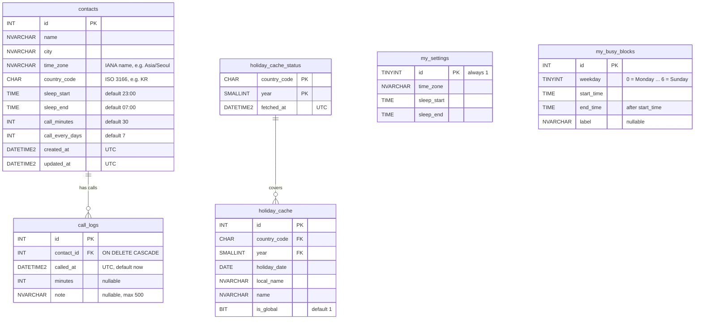

# Data model

Each service owns its own database, as the brief requires: contacts-service uses the
`contacts` database and overlap-service uses the `overlap` database. Neither service reads
the other's tables. Everything below matches the migration files in
`contacts-service/migrations/` and `overlap-service/migrations/`.

## Diagram

The diagram shows two separate databases. `contacts` and `call_logs` live in
contacts-service's database; the other four tables live in overlap-service's database.

## contacts-service database

### `contacts` (migration 001)

One row per person the user wants to call. This is the core entity with full CRUD
(`/contacts`).

- `time_zone` is an IANA name such as `Asia/Seoul`. The API rejects names that do not exist.
- `country_code` is a two-letter ISO code, used to look up that country's public holidays.
- `sleep_start` and `sleep_end` are the contact's local sleeping hours. Sleep can cross
  midnight (23:00 to 07:00).
- `call_minutes` is the usual call length, and `call_every_days` how often the user wants
  to call this person. Together with the last call they drive the overdue ranking.

### `call_logs` (migration 002)

One row per call the user made (`/contacts/{id}/calls`).

- **One contact has many calls** (`contact_id` is a foreign key to `contacts.id`).
- `ON DELETE CASCADE`: deleting a contact also deletes its calls, so no call is left
  pointing at a contact that no longer exists.
- `called_at` is stored in UTC. The API returns each contact's latest `called_at` as
  `last_called`; it is computed when read, not stored, so it can never be out of date.
- The index `ix_call_logs_contact_called (contact_id, called_at DESC)` makes "latest call
  for this contact" fast.

## overlap-service database

### `holiday_cache_status` and `holiday_cache` (migration 001)

A cache of public holidays from the Nager.Date API, so each country and year is fetched
once instead of on every request.

- `holiday_cache_status` has one row per country and year that was fetched (composite
  primary key `country_code` + `year`). It records the fetch even when a country has no
  holidays, so the service does not ask again.
- `holiday_cache` holds the holidays themselves. **One fetched country-year has many
  holidays**: (`country_code`, `year`) is a foreign key to `holiday_cache_status`.
- The unique constraint on (`country_code`, `holiday_date`, `name`) stops the same holiday
  being stored twice, and `ix_holiday_cache_lookup` makes "holidays for this country on
  this date" fast.

### `my_settings` and `my_busy_blocks` (migration 002)

The user's own week, edited from "My week" in the UI (`/me`). Login is out of scope, so
there is one demo user.

- `my_settings` has exactly one row: a check constraint forces `id = 1`. It holds the
  user's time zone and sleeping hours.
- `my_busy_blocks` holds weekly busy times such as "every Monday 09:00 to 11:00, Class".
  Check constraints keep `weekday` between 0 and 6 and `end_time` after `start_time`.
- The migration inserts a starting schedule (Europe/Madrid, four morning classes), so
  suggestions work before the user edits anything.
- These two tables are not linked to each other by a key: there is only one user, so every
  busy block belongs to them.

## How the two services are linked

There is **no foreign key between the services**, because each one has its own database
and a database cannot reference another database's tables. The link happens over HTTP at
request time:

1. overlap-service calls `GET /contacts` on contacts-service.
2. It uses each contact's `id`, `time_zone`, `sleep_start`, `sleep_end`, `call_minutes`,
   `call_every_days` and `last_called` to build call windows and the overdue ranking, and
   `country_code` to look up holidays.
3. `/suggestions` returns each result with that contact's `contact_id`, so the UI can match
   it to the person on the contacts page.

overlap-service stores no contact data itself. The consequence: if contacts-service is
down, overlap-service cannot make suggestions and answers with a clear error, while
contacts-service keeps working on its own.

## Migration bookkeeping

Each database also has a `schema_migrations` table, created by the migration runner
(`app/migrations.py`) rather than by a migration file. It records which migration files
have run, so restarting a container never runs a migration twice.
