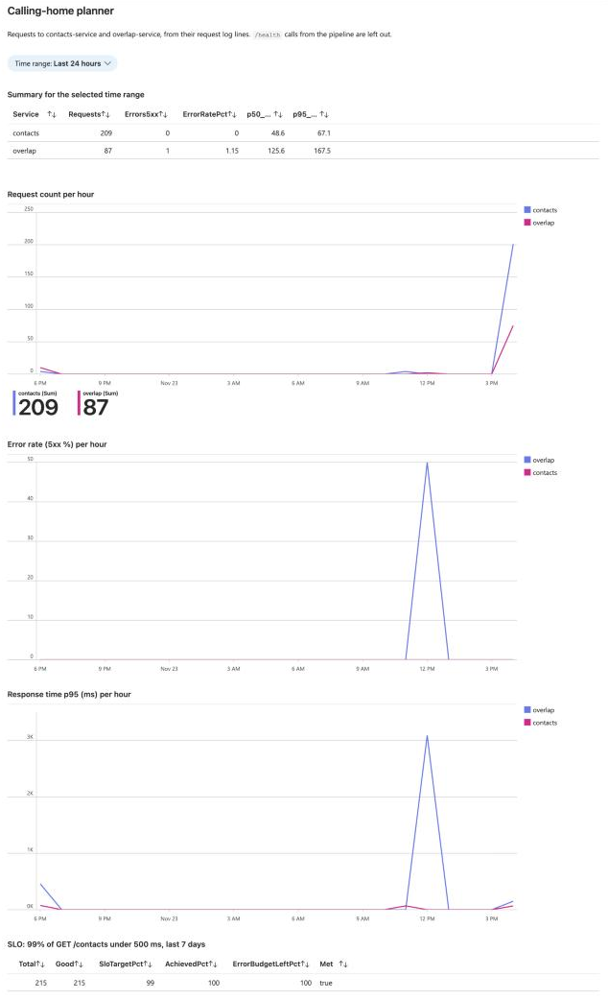

# Monitoring

Everything is built on the Log Analytics workspace `sdd-3b-g5-logs`, which the Container
Apps environment sends all container output to. Defined in
[`infra/monitoring.bicep`](../infra/monitoring.bicep).

## Where the data comes from

Each service logs one line per request at INFO level, with no request bodies
(`app/logging_middleware.py`):

```
2026-11-22 17:50:30,888 INFO contacts.requests method=GET path=/contacts status=200 duration_ms=44.3
```

These lines land in the table `ContainerAppConsoleLogs_CL`, column `Log_s`. The workspace
keeps them 30 days and caps ingestion at 1 GB a day.

## The dashboard

**Azure portal > Monitor > Workbooks > `sdd-3b-g5 monitoring`** (or open the workspace
`sdd-3b-g5-logs` > Workbooks). One page with:

| Part | What it shows |
| --- | --- |
| Summary table | Per service, for the selected range: requests, 5xx errors, error rate, p50 and p95 |
| Request count per hour | Traffic per service (hours without requests are 0) |
| Error rate (5xx %) per hour | Share of requests the service failed |
| Response time p95 (ms) per hour | 95% of requests were faster than this |
| SLO table | The SLO below, always over the last 7 days |

The time range at the top (1 hour to 7 days) applies to everything except the SLO table.
`/health` calls are left out: the pipeline makes them on every deploy, so they say nothing
about real use. The Workbook draws hours without traffic as 0 on the error-rate and p95
charts; the summary table has the exact numbers.



The same queries are saved in the workspace under **Logs > Queries > Calling-home planner**,
so they can be run and changed by hand.

## Queries

`RequestLogs` is a saved workspace function that turns the log line into columns. The other
queries start from it.

```kusto
// RequestLogs
ContainerAppConsoleLogs_CL
| where Log_s has ".requests method="
| parse Log_s with * " method=" Method " path=" Path " status=" Status:int " duration_ms=" DurationMs:real
| extend Service = replace_string(ContainerAppName_s, "sdd-3b-g5-", "")
| project TimeGenerated, Service, Method, Path, Status, DurationMs
```

```kusto
// Summary per service (the table at the top)
RequestLogs
| where Path != "/health"
| summarize Requests = count(), Errors5xx = countif(Status >= 500), p50_ms = round(percentile(DurationMs, 50), 1), p95_ms = round(percentile(DurationMs, 95), 1) by Service
| extend ErrorRatePct = round(100.0 * Errors5xx / Requests, 2)
| project Service, Requests, Errors5xx, ErrorRatePct, p50_ms, p95_ms
```

```kusto
// Request count per service and hour (make-series fills quiet hours with 0)
RequestLogs
| where Path != "/health"
| make-series Requests = count() default = 0 on TimeGenerated step 1h by Service
| render timechart
```

```kusto
// Error rate (5xx %) per service and hour
RequestLogs
| where Path != "/health"
| make-series Requests = count(), Errors = countif(Status >= 500) on TimeGenerated step 1h by Service
| extend ErrorRatePct = series_multiply(series_divide(Errors, Requests), 100)
| project TimeGenerated, Service, ErrorRatePct
| render timechart
```

```kusto
// Response time p95 per service and hour
RequestLogs
| where Path != "/health"
| make-series p95_ms = percentile(DurationMs, 95) default = real(null) on TimeGenerated step 1h by Service
| render timechart
```

### Results on 23 Nov

To have real numbers, we sent 200 requests to the live services on 23 Nov around 15:10 UTC
(120 `GET /contacts`, 75 `GET /suggestions`, 5 to a path that doesn't exist). Last 24
hours, without `/health`:

| Service | Requests | 5xx | Error rate | p50 | p95 |
| --- | --- | --- | --- | --- | --- |
| contacts | 209 | 0 | 0% | 48.6 ms | 67.1 ms |
| overlap | 87 | 1 | 1.15% | 125.6 ms | 167.5 ms |

contacts-service got 196 `GET /contacts` in that hour although we sent 120: the other 76
came from overlap-service, which fetches the contacts for every `/suggestions`. The one
5xx is a `GET /suggestions` at 11:05 UTC that answered 503 after 3.09 s. 3 s is overlap's
timeout for calling contacts-service, which was still starting, so overlap gave its
"suggestions unavailable" answer instead of failing. The logs around each cold start also
show `database not ready (attempt 1/10)` warnings while the database resumes; the retries
then connect.

## SLO

**99% of `GET /contacts` requests are answered without a server error in under 500 ms,
measured over the last 7 days.**

`GET /contacts` is the request every page of the UI starts with, so if it is slow or
failing, the whole app feels broken. 500 ms is well above what we see normally (p95 around
67 ms on 23 Nov) and leaves room for a database that has just resumed. The error budget is
the 1% of requests allowed to miss.

```kusto
RequestLogs
| where TimeGenerated > ago(7d)
| where Service == "contacts" and Method == "GET" and Path == "/contacts"
| summarize Total = count(), Good = countif(Status < 500 and DurationMs < 500)
| extend SloTargetPct = 99.0, AchievedPct = round(100.0 * Good / Total, 2)
| extend ErrorBudgetLeftPct = round(100.0 * (1 - (Total - Good) / (0.01 * Total)), 1)
| extend Met = AchievedPct >= SloTargetPct
```

**Current value (23 Nov):** 215 of 215 requests good, 100% achieved, error budget
untouched. The SLO is met.

### If the SLO is breached

When `Met` is false (or the error budget is close to 0):

1. Open the Workbook and find the hours where p95 or the error rate of contacts-service
   jumps.
2. Look at those requests and the log lines around them:
   `RequestLogs | where Service == "contacts" and (Status >= 500 or DurationMs >= 500)`,
   then `ContainerAppConsoleLogs_CL` for warnings or tracebacks at the same time.
3. Check whether a deploy happened then (GitHub Actions, Deploy runs on `main`). If the
   breach started with a deploy, revert that commit; the pipeline redeploys the previous
   version.
4. If it's the database resuming or a cold start, that is accepted for this project; if
   it happens during normal use, the fix would be a minimum of 1 replica, which costs
   money all the time.
5. Until the budget recovers, the team fixes reliability before adding features.

### What the SLO does not see

- **Cold starts.** After a quiet period the first request gets 503 "App port is not
  ready" from Azure while the container starts. That answer comes from Azure's ingress,
  not our code, so it never appears in our log lines. The UI tells the user the service
  may be starting up and offers a retry (see decision record 3).
- **Low traffic.** With a handful of requests a day, one slow request is more than 1% of
  the total. The number is only meaningful once there is real use.

## Deploying it

After `infra/main.bicep` (the workspace must exist):

```bash
az provider register -n Microsoft.Insights
az deployment group create -g rg-sdd-3b-g5 -f infra/monitoring.bicep
```
